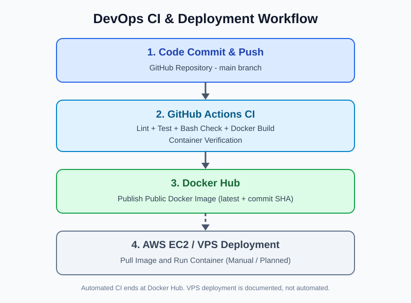

# Care Guide - DevOps Intern Screening Task

A simple Node.js application demonstrating Docker containerization, CI automation with GitHub Actions, Docker Hub image publishing, and Linux system health monitoring.

## 1. Project Overview

This project includes:

- A Node.js and Express.js application returning a JSON response.
- A lightweight Docker image running as a non-root user.
- Docker Compose for running the application locally.
- GitHub Actions for automated linting, testing, building, and image publishing.
- A Bash script for monitoring CPU, memory, and disk usage.

## 2. Technology Stack

- Node.js 24 and Express.js
- Docker and Docker Compose
- GitHub Actions
- Docker Hub
- ESLint and Node.js Test Runner
- Bash Scripting
- AWS EC2 (testing environment)

## 3. Architecture Diagram



The CI pipeline automatically checks the code, builds and tests the Docker image, and publishes it to Docker Hub. Deployment to a VPS is shown as a separate deployment step.

## 4. Run the Application

### Prerequisites

- Git
- Docker Engine
- Docker Compose

### Clone the Repository

```bash
git clone https://github.com/Iftisam-sandik/care-guide-devops-screening.git
cd care-guide-devops-screening
```

### Build and Start

```bash
docker compose up -d --build
```

Docker Compose v2 uses `docker compose`. The legacy equivalent is `docker-compose up`.

### Verify the Application

```bash
curl http://127.0.0.1:8080/
```

Expected response:

```json
{
  "message": "Hello from DevOps Intern Task!",
  "status": "running"
}
```

The application runs on port 8080 and is bound to localhost for local testing.

### Stop the Application

```bash
docker compose down
```

Note: On Linux, Docker commands may require `sudo` depending on the user's Docker permissions.

## 5. Linux System Health Monitoring

The `system_health.sh` script checks:

- CPU usage percentage
- Memory usage percentage
- Root filesystem disk usage percentage

Each execution appends a timestamped entry to `health_log.txt`.

### Run the Script

Run the following commands on a Linux system:

```bash
chmod +x system_health.sh
./system_health.sh
```

The script uses standard Linux utilities, including `vmstat`, `free`, `df`, and `awk`. The `vmstat` command is provided by the `procps` package on Ubuntu.

### Example Output

```text
2026-11-07 14:12:33 +0600 | CPU: 0% | Memory: 44% | Disk: 21%
```

Timestamps use the Asia/Dhaka timezone (UTC+06:00).

If disk usage exceeds 80%, the script prints:

```text
[WARNING] Disk space high!
```

The generated `health_log.txt` file is excluded from Git.

## 6. GitHub Actions CI Pipeline

The workflow is defined in `.github/workflows/ci.yml`.

Every push to the `main` branch triggers:

1. Checkout the source code.
2. Set up Node.js and install dependencies.
3. Run ESLint checks.
4. Run automated application tests.
5. Check Bash script syntax.
6. Build and test the Docker image.
7. Authenticate with Docker Hub using GitHub Secrets.
8. Push the Docker image to Docker Hub.

The image is published with `latest` and Git commit SHA tags after successful checks.

[View GitHub Actions](https://github.com/Iftisam-sandik/care-guide-devops-screening/actions)

## 7. Docker Hub Image

Public repository:

[iftisamsandik/care-guide-devops-screening](https://hub.docker.com/r/iftisamsandik/care-guide-devops-screening)

Pull the published image:

```bash
docker pull iftisamsandik/care-guide-devops-screening:latest
```

## 8. Deployment Approach - AWS EC2 / VPS

For a production deployment, I would:

1. Launch an Ubuntu-based AWS EC2 instance or VPS, configure SSH access, and install Docker.
2. Pull the published image from Docker Hub and run the container with the required port mapping and restart policy.
3. Configure network access using security groups or firewall rules, and use a reverse proxy with HTTPS for secure public access.

Actual VPS deployment is outside the required implementation scope of this screening task.

## 9. Repository

Source code:

https://github.com/Iftisam-sandik/care-guide-devops-screening
